# Inspection and audit ordering agents

Two agents that run commercial insurance inspection ordering and premium audit ordering from start to finish. A daily sweep applies versioned business rules to the policy book to decide which policies need a loss-control survey or a premium audit, which type, which vendor and on what date. The agents place the orders over vendor APIs or by email, follow the vendor change feeds and a shared mailbox, chase vendors and remind insureds on schedule, and read the completed reports, OCR'ing scans where needed. They then check every extracted value against the document, reconcile audited payroll to earned premium, and post the result to the policy system. Anything outside the agents' authority, or anything they cannot verify, goes to an exception queue for the role that owns the decision. A Streamlit dashboard shows straight-through rates, the queue and a hash-chained trail for every order.

This is a reference implementation of the architecture behind a platform I built for a mid-sized MGA writing workers' compensation and general liability programs for small contractors. The production build is under NDA, so a few integrations are abstracted behind adapters: the policy administration system is a Postgres schema, and the two vendor APIs, the email-only vendor, the insureds and the shared mailbox are a simulator service. It runs on synthetic data, and every company, place, person, phone number and figure in it is made up.

[](https://github.com/AlexKurinets/inspection-and-audit-ordering-agents/actions/workflows/ci.yml)

## Architecture

```mermaid
flowchart LR
    PAS[("Policy admin system<br/>pas schema")] -->|policies, exposures,<br/>cancellations| SWEEP["Rules sweep<br/>rules/ordering_rules.yaml"]
    SWEEP -->|one order per key| SM["Order state machine<br/>ops.orders + hash-chained ops.events"]
    SM -->|"REST + Idempotency-Key"| VAPI["Vendor APIs<br/>LFS surveys, HAP audits"]
    SM -->|order form, reminders| MAIL["Shared mailbox<br/>QRS desk surveys, insureds"]
    VAPI -->|change feed, PDFs| SM
    MAIL -->|replies, attachments| READ["Claude or offline stand-in<br/>email intent, report fields + quotes"]
    VAPI -->|reports| OCR["PDF text layer or<br/>Tesseract OCR"] --> READ
    READ --> CHECK["Checks<br/>quotes found, rows add up,<br/>period, class codes"]
    CHECK --> REC["Reconcile payroll<br/>to earned premium"]
    REC -->|within authority| POST["Post to policy system"]
    REC -->|outside authority| Q["Exception queue<br/>audit reviewer, underwriter, ops lead"]
    CHECK -->|failed check| Q
    Q -->|approve or reject| SM
    API["FastAPI"] --- SM
    DASH["Streamlit dashboard"] --> API
```



Compose runs five services: `db` (Postgres 16), `sim` (the outside world), `api` (seeds on first start, then serves), `worker` (runs a tick every 5 seconds) and `dashboard` (Streamlit). Agents reach the simulator only over HTTP and the policy system only through `src/opsagents/integrations/pas.py`.

## Design decisions

**The rules decide and the model reads.** Whether a policy needs an order, the audit type, the vendor and the order date all come from `rules/ordering_rules.yaml` through pure functions in `src/opsagents/rules.py`. Physical audits go out 30 days before expiration so the vendor can book the week after, phone and self-audits go out at expiration, cancellations are ordered on the day the cancellation is processed, and general liability under $2,500 of deposit premium is waived. The model never chooses any of this. An early version of the production system let a tool-calling agent make those calls, and it sometimes picked a phone audit where a physical one was required.

**Every order is an explicit state machine with a hash-chained trail.** `src/opsagents/orders.py` holds the transition table. Every change writes an event whose SHA-256 covers its own fields and the previous event's hash (`src/opsagents/trail.py`), and a trigger in `src/opsagents/schema.sql` rejects UPDATE and DELETE on `ops.events`. Only an actor named `human:` can move an order out of `in_review`, so the agent cannot approve its own exception.

**Identification and vendor orders are idempotent.** Each order has a deterministic key (`AUD:<policy>:<period start>:<period end>`), unique in the database, so the daily sweep can run any number of times. The same key goes to the vendor as an `Idempotency-Key`, so when a vendor accepts an order but the response times out, the retry gets the same vendor reference back instead of placing a second order (`submit_order` in `src/opsagents/integrations/outside.py`). Three days of failed submissions open a `vendor_unreachable` exception for the ops lead.

**Vendor status comes from change feeds, not polling.** The agents keep a cursor per vendor feed and per mailbox in `ops.cursors` and process each change in its own transaction, so a crash replays at most one change, and handlers are safe to replay. Orders are claimed with `FOR UPDATE SKIP LOCKED`, so several workers can share a tick. A second tick on the same day does nothing, which a test checks.

**Every extracted value carries a quote, and code checks it.** The model returns a fixed Pydantic schema (`src/opsagents/llm/base.py`) in which each value comes with the verbatim text it was read from. `src/opsagents/documents/verify.py` requires each quote to be found in the document and each value to be found in its quote. Audit rows must also add up to the stated total within $1, the period must match the policy period, and every class code must exist. Whitespace is ignored inside the value check because OCR splits numbers ("0001 26"). A worksheet that fails any check goes to a person with the failed checks listed.

**Authority limits live in configuration.** The audit agent posts an adjustment on its own only when it is within $2,500 and 25 percent of the deposit premium. Larger adjustments go to an audit reviewer. Payroll in a class that is not on the policy goes to an underwriter, as does any inspection with a Critical recommendation or a Poor rating. The limits and the role for each exception reason are in the `authority` section of the rules file. The API never posts anything itself: approving records the decision, and the worker carries it out.

**The model gets nothing it could misuse.** It has no tools and no credentials, the document is passed as data, and outbound email is always a fixed template (`src/opsagents/agents/templates.py`), because these messages go to insureds and vendors. `LLM_PROVIDER=claude` uses `src/opsagents/llm/claude.py` (structured outputs through `messages.parse`); the default is a deterministic offline stand-in that parses the simulator's layouts, so the demo and tests run without an API key.

## Running it

```bash
cp .env.example .env    # optional: change host ports or set LLM_PROVIDER=claude and ANTHROPIC_API_KEY
docker compose up -d --build --wait --wait-timeout 900
```

On first start the `api` service generates a synthetic book of 1,300 policies (150 expired in the year before, 900 in force, 250 new business) and simulates 1 March to 30 June 2026 one business day at a time, with simulated reviewers working the queue until four days before the end. That takes about two minutes. Then:

- Dashboard: http://localhost:8540 (overview, exception queue, orders and vendors, order trail)
- API: http://localhost:8140/docs
- Simulator: http://localhost:8141/docs

The seeded run ends with these figures, which `scripts/smoke.sh` asserts: 548 orders, 477 finished, 372 of them (78 percent) with no person involved, 62 of 69 audits done within 90 days of the period end, and 20 expired policies found on the first sweep with no audit ever ordered.

```bash
docker compose exec api opsagents status          # the dashboard's summary as text
docker compose exec api opsagents verify-trail    # recompute every order's hash chain
```

Approve an exception the way the dashboard does. Exception 107 is an open variance review on order 509, a self-audit whose adjustment is about 40 percent of the deposit. The demo role tokens are in `.env.example`.

```bash
curl -s http://localhost:8140/exceptions
curl -s -X POST http://localhost:8140/exceptions/107/resolve \
  -H "X-Role-Token: demo-audit-reviewer" -H "Content-Type: application/json" \
  -d '{"action": "approve", "note": "Checked against the self-audit form"}'
curl -s http://localhost:8140/orders/509
```

Within five seconds the worker posts the adjustment and closes the order, and the endorsement shows `posted_by: ops-agent, approved by human:audit_reviewer`.

Move the business date forward, and measure extraction accuracy on generated reports with known answers. With the offline stand-in the second command only shows how the harness works; with `LLM_PROVIDER=claude` it measures the model.

```bash
docker compose exec api opsagents advance --days 1
docker compose exec api opsagents eval-extraction --n 20
```

## Tests

52 tests run against a real Postgres. They cover the ordering rules, rendering and reading reports including OCR of a scan, every verification check, premium reconciliation and authority limits, the state machine and role checks, tampering with the trail, a lost vendor response, a three-day vendor outage, a three-and-a-half-month simulation of a small book, the API, the Claude adapter against a stub client, and a render of every dashboard page.

```bash
docker compose exec db psql -U ops -d ops -c "CREATE DATABASE ops_test"
docker compose run --rm -e TEST_DATABASE_URL=postgresql://ops:ops@db:5432/ops_test api pytest -q
```

Without Docker you need Python 3.12, Tesseract and a Postgres reachable at `TEST_DATABASE_URL`, then `pip install -e ".[dashboard,dev]"` and `pytest`. CI runs the tests and ruff on Ubuntu, then builds the Compose stack and runs `scripts/smoke.sh`, which executes every command in this README.

## Layout

```
rules/ordering_rules.yaml        the ordering rules, authority limits and exception roles
src/opsagents/rules.py           rules as pure functions: inspection_decision, audit_decision
src/opsagents/orders.py          state machine, exception queue, resolve_exception
src/opsagents/trail.py           hash-chained event log and verification
src/opsagents/agents/            the agents: daily tick, per-order steps, email templates
src/opsagents/llm/               model interface, Claude adapter, offline stand-in
src/opsagents/documents/         PDF text and OCR, extraction checks
src/opsagents/reconcile.py       audited payroll to earned premium, authority check
src/opsagents/integrations/      policy system adapter, vendor and mailbox client
src/opsagents/synthetic/         synthetic book, class manual, the day-by-day driver
src/opsagents/api.py             FastAPI for the dashboard and for resolving exceptions
src/vendorsim/                   simulated vendors, insureds and mailbox, report PDFs
dashboard/                       Streamlit app
tests/                           pytest suite
scripts/smoke.sh                 runs every README command against the stack
```

## What is deliberately left out

- The real integrations: the carrier's policy admin API, the underwriting workbench, the vendors' production APIs and Microsoft Graph for the shared mailbox. Each is one adapter here.
- Single sign-on. Roles are static tokens from an environment variable; production mapped them from the identity provider.
- Cancelling a vendor order when a policy cancels mid-survey, and reordering when a vendor's report is rejected.
- Live model calls in CI. The Claude adapter is exercised only when you set `LLM_PROVIDER=claude` with your own key.
- Rate-filing details such as experience modifiers, minimum premiums and state-specific audit rules.

## License

MIT, Alex Kurinets
